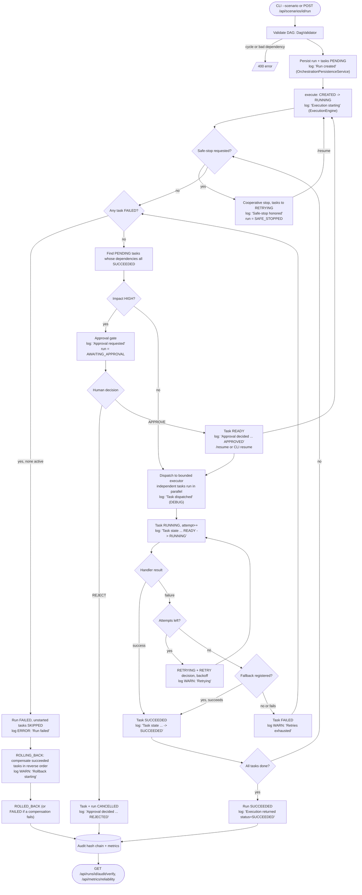

# Architecture

The production profile is configured for PostgreSQL and OIDC/JWT; current automated verification uses H2 and MockMvc tokens, not live production services.

## Runtime overview

The application is a single Java 21 / Spring Boot 3.5 Maven service. URL-shortener and orchestration domains are separate packages using Spring Data JPA. Local development and tests use H2; the `prod` profile targets PostgreSQL with Flyway migrations and Hibernate schema validation. REST and CLI entry points call the same orchestration services.

```text
                           ┌────────────────────────────┐
                           │ REST controllers           │
                           │ shortener / runs / approvals│
                           │ scenarios                  │
                           └──────────────┬─────────────┘
                                          │
                           ┌──────────────▼─────────────┐
                           │ OrchestrationRunService    │
                           │ ScenarioService            │
                           └──────────────┬─────────────┘
                                          │
       ┌──────────────────────────────────▼────────────────────────────────┐
       │ ExecutionEngine: persisted DAG scheduler, state transitions,       │
       │ dependency synchronization, bounded parallelism / sequential mode │
       └──────┬────────────┬───────────────┬──────────────┬─────────────────┘
              │            │               │              │
       retry/fallback  approvals        safe-stop      replanning
       compensation    human decision   cooperative     affected DAG nodes
              │            │               │              │
       ┌──────▼────────────▼───────────────▼──────────────▼─────────────────┐
       │ Spring Data JPA: runs, task executions, events, decisions,         │
       │ approval requests, artifact versions, short URLs, click events    │
       └───────────────────────────────────────────────────────────────────┘

       AgentTaskHandler ──> typed Agent SPI ──> LlmProvider
              │                                   └── MockLlmProvider (default)
              └── PolicyEngine / ArtifactVersionService / sandbox

       RegisteredCheckTaskHandler ──> allow-listed RegisteredCheck implementations
       URL API ──> ShortUrlService ──> ShortUrlRepository / ClickEventRepository
       AuditHashService ──> per-run sequence + SHA-256 chain + run tip anchor
       ReliabilityMetricsService ──> persisted run/event/decision/approval aggregates
       SecurityConfiguration ──> loopback demo / OIDC-JWT production profile
```

## Package responsibilities

- `shortener`: URL validation, local/private destination checks, alias creation, configurable expiration, redirect/click recording, statistics API.
- `security`: loopback-development defaults and production-profile OIDC JWT authorization (issuer, audience and operator scope).
- `api`: OpenAPI metadata and the documented bearer-token security scheme; generated documentation is local-profile-only.
- `orchestration.dag`: typed task definitions, dependency graph construction, and validation.
- `orchestration.engine`: scheduler, execution modes, state persistence, retry/fallback, compensation, and safe-stop.
- `orchestration.approval`: persisted approval decisions, REST API, and HIGH-impact dispatch gate.
- `orchestration.replan`: replacement DAG validation, dependency-change detection, downstream invalidation, and lineage.
- `orchestration.api`: run facade, run REST endpoints, task state views, and audit export.
- `agents` / `llm`: task-to-agent mapping and LLM provider boundary. The deterministic mock is the no-key default.
- `guardrails`: typed operation/check allowlists, risk and path policy, secret scanning, sandbox writes, and artifact versions.
- `scenarios`: fixed greenfield, brownfield, and ambiguous DAG definitions, scenario REST API, and CLI runner.
- `scenarios.checks`: Java-implemented checks for baseline shortener behavior and default-expiration/expired-link regression.
- `audit`: canonical event hashing and per-run integrity verification.
- `metrics`: persisted reliability aggregates and REST metrics API.

## Execution and synchronization

The engine validates and persists the whole DAG before execution. A bounded executor starts tasks whose dependencies have all succeeded. Dependent tasks receive only completed dependency outputs and are not scheduled before their prerequisites finish. Sequential mode uses a per-run parallelism limit of one; parallel mode uses the configured maximum. Task and run transitions and events are persisted as work is scheduled and completed.

Each task has a bounded retry policy. After exhaustion, the engine can invoke a registered fallback. Unrecoverable failure triggers compensation for completed tasks in reverse topological order. Safe-stop is cooperative: tasks check the per-run/global stop state, execution waits within configured limits, and a stopped run can be resumed explicitly. A pessimistic run-row lock makes the transition into RUNNING an atomic execution claim, so concurrent callers cannot dispatch the same run twice against the same database.

## Approval and change control

HIGH-impact task definitions trigger a persisted approval request before dispatch. Rejection cancels the task/run; approval stores the human rationale and decision lineage and permits later execution. Scenario labels do not bypass risk gates. Artifacts are typed proposals, written under the sandbox after policy/path/secret checks and recorded as versioned outputs linked to the producing decision. In the production profile, approval/run/scenario/metrics APIs require a validated OIDC JWT with the configured issuer and audience and the `agentic.operator` scope. Approval identity is derived from the JWT subject. The default profile is intended only for loopback development.

Checks are selected by fixed Java mappings. The model cannot provide a command line, shell script, or arbitrary check identifier for execution.

## Replanning and lineage

Replanning is accepted only when a run is not actively executing, waiting on approval, or stopped. The replacement DAG is validated before persistence. Input changes, task changes, and updated upstream outputs invalidate affected downstream work while preserving unaffected successful work. Removed tasks remain as retired records for history. Agent, policy, approval, retry, fallback, and replan decisions are stored with parent links where available.

Each run's events have a contiguous sequence number, previous-event hash, and SHA-256 event hash. Event writes lock the run row so concurrent task completions append to one ordered chain. The run stores the current sequence/hash tip; `GET /api/runs/{runId}/audit/verify` checks event content, sequence/link consistency, and the anchor. Audit exports include event sequence and hash values.

## Reliability metrics

`GET /api/metrics/reliability` derives aggregates from persisted records:

- Success rate is successful runs divided by terminal runs (`SUCCEEDED`, `FAILED`, `ROLLED_BACK`, and `CANCELLED`).
- Retry count is the number of persisted `RETRY` decisions. Rollback frequency is rolled-back runs divided by terminal runs.
- MTTR is the mean from the earliest retry/failure/rollback signal to terminal completion for runs that eventually succeed or complete rollback.
- End-to-end latency is run creation to terminal update, reported at p50 and p95.
- Approval wait is request to decision, reported as mean and p95 for decided approvals only.

Ratios are fractions from 0 to 1 and durations are milliseconds. Empty populations produce zero values; sample counts distinguish missing data.

## Network and API security

The default configuration binds to `127.0.0.1`. The `prod` profile binds to `SERVER_ADDRESS` (default `0.0.0.0`) and requires an HTTPS `APP_OIDC_ISSUER_URI` and `APP_OIDC_AUDIENCE`; missing or invalid OIDC configuration fails application startup. A JWT must match the issuer and audience and include the `agentic.operator` scope to access orchestration, approvals, reliability metrics, Actuator endpoints other than health, and click analytics. Link creation and redirects remain public by design. Production deployments must provide TLS (directly or at a trusted gateway), network isolation, and gateway rate limits.

Destination validation rejects literal loopback/private/link-local/shared IP ranges, numeric address variants, and common local-only hostname suffixes without resolving DNS. This avoids create-time DNS dependencies but cannot prevent a public hostname from resolving to a private address or changing after creation. A resolver-aware allowlist/egress policy belongs at the deployment boundary.

## Entry points

- URL API: `POST /api/urls`, `GET /{code}`, `GET /api/urls/{code}/stats`.
- Orchestration REST: `/api/runs`, `/api/approvals`, and `/api/scenarios`.
- OpenAPI: `springdoc-openapi` generates the API contract and local Swagger UI. The default profile serves `/v3/api-docs` and `/swagger-ui/index.html`; the `prod` profile disables both and the production security chain denies their routes. Protected operations are documented with the `bearerAuth` scheme and the `agentic.operator` scope requirement.
- CLI: Spring Boot `ApplicationRunner` accepts `--scenario=<id>` and optional `--mode=SEQUENTIAL|PARALLEL`; it delegates to `ScenarioService`. Optional `--decision=APPROVE|REJECT --approver=<name>` (plus `--rationale`, `--safe-stop-before-resume`) delegates the human decision, resume and safe-stop steps to `ScenarioLifecycleService`, which calls the same `ApprovalService` and `OrchestrationRunService` as the REST controllers. Decisions are never inferred or automatic.

## Execution flow

Every box below is traceable in the logs through the `runId` and `task` fields. The messages in quotes are the actual log lines emitted (logger name in parentheses).



Dynamic replanning (`POST /api/runs/{id}/replan`, log `Replan applied`) is allowed only from `CREATED`, `SAFE_STOPPED`, `SUCCEEDED` or `ROLLED_BACK` with no pending approval. It invalidates only the affected downstream tasks, preserves the rest, resets the run to `CREATED`, and the flow re-enters at `execute`.

## Logging

SLF4J through Spring Boot's default Logback; no new dependency. Configuration is in `application.yml` (`logging.level.com.schwab.agentic`, console pattern `time level [thread] logger - message`).

| Level | What is logged                                                                                                                                           |
| ----- | -------------------------------------------------------------------------------------------------------------------------------------------------------- |
| INFO  | Run created, run and task state transitions, decisions recorded, approval requested/decided, resume, replan applied, execution result, short URL created |
| WARN  | Retry, retries exhausted, fallback invoked, safe-stop requested/honored, rollback starting, alias conflict, task FAILED                                  |
| ERROR | Run failed                                                                                                                                               |
| DEBUG | Task dispatch, click recorded (enable with `logging.level.com.schwab.agentic=DEBUG`)                                                                     |

Rules followed: identifiers and states only; destination URLs, referrers, user agents, approval rationales and credentials are never logged; the caller-supplied approver name has line breaks stripped to prevent log forging. Logs are operational diagnostics; the hash-chained audit events remain the system of record.

## Database and deployment profiles

- Default profile: in-memory H2 for the assessment demo, no durability across process restart.
- `prod` profile: PostgreSQL connection via `DATABASE_URL`, `DATABASE_USERNAME`, and `DATABASE_PASSWORD`; database TLS defaults to `verify-full` (`DATABASE_SSL_MODE` may select `require`, `verify-ca`, or `verify-full`). Configuration rejects missing values, non-PostgreSQL URLs, embedded credentials, and disabled TLS. Flyway applies versioned scripts from `src/main/resources/db/migration`; Hibernate uses `ddl-auto=validate`, not automatic schema mutation.
- Production authentication: HTTPS OIDC issuer (`APP_OIDC_ISSUER_URI`), required JWT audience (`APP_OIDC_AUDIENCE`), and `agentic.operator` OAuth scope. Use a secrets manager and a real identity provider; no credentials belong in repository configuration.
- Place the service behind a trusted TLS gateway with network restriction and rate limits. Neither TLS termination nor rate limiting is implemented here.

## Data and limitations

The production profile and PostgreSQL migration are configuration/schema support, not evidence of a deployed production service. The PostgreSQL migration has been exercised against H2 compatibility and Hibernate validation; no live PostgreSQL server or OIDC issuer was available in this run. Backups/restore, HA, connection/pool tuning, crash recovery, distributed leases, monitoring/alerting, load testing, vulnerability scanning, penetration testing, TLS gateway configuration, and gateway rate limits remain unverified or unimplemented. The default LLM provider is deterministic mock output. Agent artifacts are not applied to source files; no generated or arbitrary commands execute. The event chain and tip anchor are in the same database and are not digitally signed or externally anchored; an attacker with full database write access could rewrite both.
